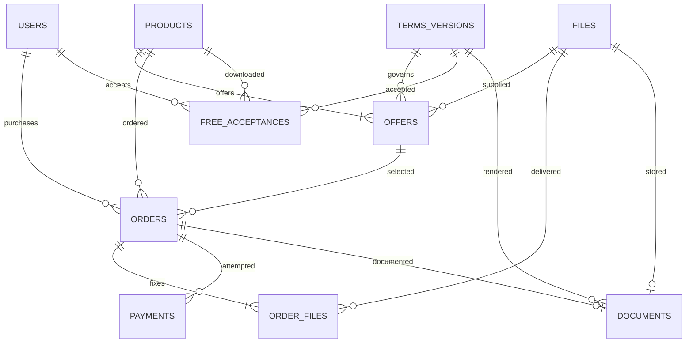

# Beatstore — модель данных MVP

Статус: проект модели для реализации в PostgreSQL. Физические таблицы, миграции и индексы создаются на этапе подготовки приложения. Служебные таблицы авторизации зависят от выбранной библиотеки.

## Общие правила

- Идентификаторы сущностей — UUID; даты и время сохраняются с часовым поясом, календарные кварталы определяются по времени Москвы.
- Денежные суммы хранятся целым числом копеек; валюта — RUB.
- Проценты хранятся точными десятичными значениями, без вычислений с двоичной плавающей точкой при расчёте цены.
- Процент скидки и роялти находится в диапазоне от 0 до 100; цены неотрицательные, платёж создаётся для положительной итоговой суммы.
- Итоговая цена обычной лицензии или драмкита: базовая цена × (100 − скидка) / 100, с округлением до копейки; для положительных сумм половина копейки округляется вверх. Эксклюзив продаётся по индивидуальной цене без скидки.
- Настройка скидки не должна превращать платную покупку в нулевой платёж. Полностью бесплатная выдача платных вариантов в MVP не реализуется; бесплатный MP3 имеет отдельный сценарий.
- Название будущего трека не хранится.
- Документы используют демонстрационные данные сторон и явную демонстрационную пометку.
- Изменяемая карточка товара отделена от неизменяемых условий заказа, его файлов и документа.

## Основные сущности

### Пользователь — `users`

Поля: `id`, `email`, `artist_name`, `role`, `created_at`, `updated_at`.

- Email нормализуется для входа и уникален; имя артиста не обязано быть уникальным.
- Роли: `CUSTOMER`, `ADMIN`; регистрация всегда создаёт покупателя, роль администратора не принимается из формы регистрации.
- Пароль хранится только в виде хеша в служебных данных выбранной библиотеки; исходный пароль не сохраняется.
- Сессии и восстановление пароля обслуживает библиотека авторизации.
- Изменение имени артиста или email не меняет данные ранее оформленного заказа.

### Товар — `products`

Общие поля: `id`, `type`, `title`, `description`, `status`, `discount_percent`, `cover_file_id`, `thumbnail_file_id`, `preview_file_id`, `duration_seconds`, `created_at`, `updated_at`.

Типы: `BEAT`, `DRUMKIT`. Состояния: `DRAFT`, `PUBLISHED`, `UNPUBLISHED`, `EXCLUSIVE_SOLD`. Название не обязано быть уникальным; карточка определяется идентификатором.

Поля бита: `authors`, `bpm`, `musical_key`, `royalty_percent`, `project_requirements`, `reserved_order_id`, `reservation_expires_at`, `exclusive_order_id`.

- `authors` — упорядоченный список имён авторов и соавторов. Отдельные аккаунты и страницы авторов не нужны.
- BPM — положительное число; тональность — обозначение, например `C minor`.
- Длительность вычисляется при обработке превью.
- Требования к проекту включают версию FL Studio, необходимые сторонние плагины и библиотеки.
- Поля бита отсутствуют у драмкита. Общий `preview_file_id` драмкита ссылается на один MP3-файл с примером звучания набора.
- Список авторов, BPM, тональность и необходимые файлы проверяются перед публикацией бита.
- Резерв эксклюзива отделён от состояния публикации: временная приостановка продаж не превращает товар в снятый с публикации.

### Вариант покупки — `offers`

Поля: `id`, `product_id`, `kind`, `base_price_kopecks`, `file_id`, `terms_version_id`.

Типы: `MP3`, `WAV`, `STEMS`, `EXCLUSIVE`, `DRUMKIT`. Пара `(product_id, kind)` уникальна.

- Бит имеет ровно четыре варианта покупки; для черновика допустимы незаполненные цены и файлы, для публикации — нет.
- Начальные цены: MP3 — 100 000 коп., WAV — 200 000 коп., STEMS — 300 000 коп.; цена эксклюзива задаётся отдельно.
- Драмкит имеет один вариант `DRUMKIT` с индивидуальной ценой и архивом.
- Бесплатный MP3 не является заказом или отдельным платным вариантом.
- Варианты не имеют переключателя активности; возможность купить определяется состоянием товара и резервом.
- Комплект каждого варианта содержит один файл: MP3, WAV, ZIP STEMS, ZIP проекта либо ZIP драмкита.

### Файл — `files`

Поля: `id`, `bucket`, `object_key`, `original_name`, `content_type`, `size_bytes`, `checksum`, `kind`, `status`, `created_at`.

Назначения: обложка, миниатюра, превью, MP3, WAV, STEMS, проект FL Studio, драмкит, документ.

- В PostgreSQL хранится описание файла, сами байты находятся в Object Storage.
- Адрес объекта состоит из бакета и ключа; временные ссылки создаются при запросе и не сохраняются в базе как постоянные адреса.
- Новый файл получает новый ключ: замена файла товара не перезаписывает объект старой покупки.
- Превью и выдаваемый MP3 — отдельные назначения; они могут ссылаться на один объект, если используется один и тот же файл.
- Файл считается готовым после проверки успешной загрузки, размера и формата; незавершённая загрузка не допускается к публикации.
- Квадратная обложка и миниатюра имеют собственные записи.
- Файлы оплаченных заказов нельзя физически удалить при редактировании товара.
- Объём всех объектов, сохраняемых версий и документов учитывается в общем лимите демонстрации 1 ГБ.

### Версия условий — `terms_versions`

Поля: `id`, `kind`, `version`, `body`, `parameters`, `created_at`.

Типы: бесплатный MP3, MP3, WAV, STEMS, эксклюзив, драмкит. Версия неизменяема: редактирование создаёт новую запись.

- Текст условий драмкита соответствует файлу правил внутри ZIP. Для MVP это проверяется при подготовке демонстрационного товара.
- Текст бесплатного использования применяется при принятии условий перед скачиванием.
- Параметры обычной лицензии включают один трек, 500 000 прослушиваний отдельно по каждой площадке, обязательное указание авторов и правила после эксклюзивной продажи.
- Параметры эксклюзива включают ранее выданные лицензии и условия роялти: доход от стриминга после комиссий, календарный квартал, 15 дней после его окончания.

### Принятие бесплатных условий — `free_acceptances`

Поля: `id`, `user_id`, `product_id`, `product_snapshot`, `terms_version_id`, `accepted_at`.

- Пара `(user_id, product_id)` уникальна: фиксируется первое принятие условий конкретного бита и его версия.
- Отсутствие принятия требует показа условий; отсутствие авторизации запрещает бесплатное скачивание.
- Запись принятия не даёт доступ к снятому с публикации или проданному в эксклюзив биту.
- Принятие новой версии условий уже скачанного бита в MVP отдельно не реализуется.
- При удалении товара без покупок ссылка на товар может очищаться; его исходный идентификатор и название остаются в снимке принятия условий.

### Заказ — `orders`

Поля: `id`, `user_id`, `product_id`, `offer_id`, `purchase_kind`, `status`, `base_price_kopecks`, `discount_percent`, `total_kopecks`, `currency`, `snapshot`, `created_at`, `expires_at`, `paid_at`, `refunded_at`.

Состояния: `AWAITING_PAYMENT`, `PAID`, `CANCELLED`, `REFUNDED`.

- Заказ содержит один товар и один вариант; таблица позиций корзины не нужна.
- `snapshot` содержит название и описание товара, авторов, данные покупателя для демонстрационного документа, цену, условия, идентификатор и текст версии шаблона, а для эксклюзива — роялти и требования к проекту.
- Снимок фиксируется сервером при оформлении. Клиент не задаёт окончательную цену или состав снимка.
- Повторная покупка того же бита разрешена; уникальность по паре пользователь–товар не устанавливается.
- Каждый оплаченный заказ обычной лицензии разрешает один трек независимо от других заказов пользователя.
- После возврата `paid_at` сохраняется как исторический факт; возврат эксклюзива не открывает повторную продажу автоматически.
- При подтверждении оплаты проверяются заказ, сумма, валюта и тестовый режим платежа.
- Для отменённого неоплаченного заказа допускается очистить ссылки на физически удалённые товар и вариант покупки; снимок заказа сохраняется. Для оплаченной или возвращённой покупки ссылки сохраняются.

### Файлы заказа — `order_files`

Поля: `order_id`, `file_id`. Пара уникальна; ссылки обеспечивают связь заказа с конкретными версиями объектов.

- Связь фиксируется при оформлении заказа, но доступ разрешается только после подтверждения оплаты.
- Последующая замена файла в `offers` не меняет файлы заказа.
- Для повторного скачивания проверяются владелец заказа и его состояние; выдаётся новая временная ссылка.

### Попытка оплаты — `payments`

Поля: `id`, `order_id`, `provider`, `provider_payment_id`, `idempotency_key`, `environment`, `status`, `amount_kopecks`, `currency`, `created_at`, `updated_at`.

- Для заказа допускаются несколько попыток оплаты, но повторная обработка успешного платежа не создаёт новую покупку.
- Ключ создания платежа уникален; внешний идентификатор уникален в пределах провайдера и окружения.
- Состояния попытки нормализуются после выбора провайдера: создание, ожидание, успех, отмена/ошибка, возврат.
- Неуспешная попытка не делает оплаченный заказ неоплаченным и не подтверждает возврат.
- В MVP используется только тестовое окружение. Данные банковских карт не хранятся.
- Повторную попытку нельзя открывать до выяснения состояния предыдущей, если она ещё может успешно завершиться.

### Документ — `documents`

Поля: `id`, `order_id`, `template_version_id`, `status`, `file_id`, `generated_at`, `last_error`.

- Один документ на заказ MP3, WAV, STEMS или эксклюзива; драмкит не создаёт документ лицензии.
- Состояния генерации: `PENDING`, `READY`, `FAILED`.
- Оплата и генерация документа — отдельные процессы: ошибка генерации не отменяет успешную оплату.
- Повтор генерации использует исходный снимок заказа и не создаёт вторую лицензию.
- Готовый документ доступен только владельцу покупки и администратору.
- Новые шаблоны или данные товара не меняют готовый документ.

## Связи

Диаграмма показывает связи завершённых данных. Черновики и ожидающая генерация допускают отсутствие файла там, где готовый товар или документ его требует. Обложки, превью и указатели резерва описаны в полях товара и не вынесены в диаграмму для читаемости.

## Ограничения и конкурентные операции

- Внешние ключи сохраняют связи заказов, товаров, вариантов и файлов. Удаление товара запрещено при наличии оплаченных или возвращённых покупок.
- Перед удалением товара без покупок неоплаченные заказы отменяются после проверки внешних платежей; их ссылки на товар, варианты и невыданные файлы очищаются, снимки заказов сохраняются. Вся операция согласуется с обработкой платежей через блокировку товара.
- Уникальный индекс по товару для заказов `EXCLUSIVE` с заполненным `paid_at` допускает только одну завершённую эксклюзивную продажу, включая исторически возвращённый платёж.
- Проверка доступности и создание любого заказа на бит выполняются в транзакции с блокировкой строки товара.
- Резерв закрепляется за конкретным заказом; другой пользователь не может занять тот же бит или оформить новую обычную покупку во время резерва.
- Перед открытием оплаты эксклюзива проверяются ранее созданные обычные платежи. Истечение локального времени не считается доказательством отмены внешнего платежа.
- Подтверждение оплаты блокирует связанные товар и заказ, обрабатывает повторные уведомления и фиксирует оплату вместе с изменением состояния эксклюзива.
- Сетевые вызовы платёжного сервиса и генерация документов не выполняются внутри длительной транзакции базы.
- Запоздалое подтверждение после снятия резерва требует сверки; оно не должно открывать вторую эксклюзивную покупку. Точный механизм зависит от провайдера.
- Опубликованный бит имеет четыре готовых варианта, обложку, превью, авторов, BPM, тональность, цену эксклюзива и процент роялти. Драмкит имеет обложку, одно MP3-превью, архив, цену и условия.
- Настройки авторства не создают автоматический расчёт долей соавторов: выплаты роялти находятся вне MVP.

## Пример покупки WAV

1. Сервер находит опубликованный бит и его вариант WAV, проверяет отсутствие резерва эксклюзива.
2. При скидке 10% базовая цена 200 000 коп. превращается в 180 000 коп.
3. Создаётся заказ с ценой 1 800 ₽, снимком авторов и условий, а также ссылкой на текущую версию WAV.
4. Создаётся тестовый платёж, его идентификатор связывается с заказом.
5. После проверенного подтверждения заказ становится оплаченным; повторное подтверждение ничего не дублирует.
6. Документ формируется из сохранённого снимка и становится доступен вместе с WAV в кабинете.
7. Изменение цены, авторов или WAV в карточке не меняет этот заказ.
8. Повторная покупка создаёт другой заказ и отдельный документ, разрешающий ещё один трек.
